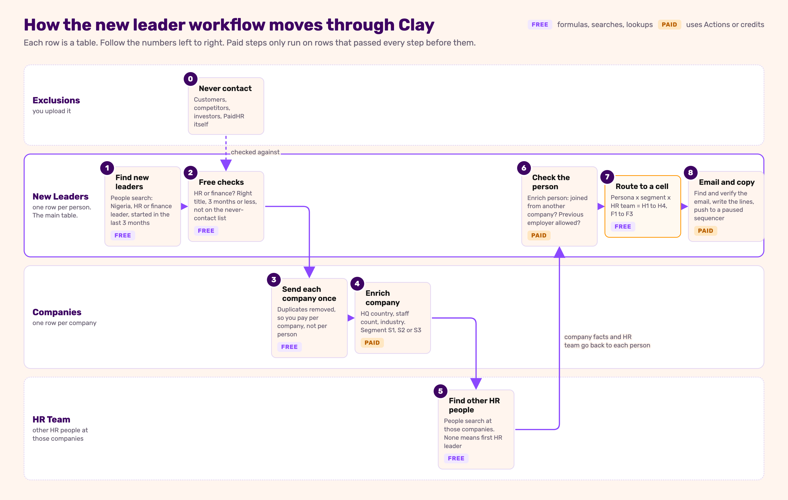

# Clay Build Guide: New HR or Finance Leader (PaidHR)

A step-by-step guide to building `workflow-spec.md` (in this folder) in Clay. Written for someone who has never built anything in Clay. Follow the parts in order. Each step tells you **why** it exists, **what to click**, **what to type**, **how to check it worked** and **what it costs**.

> **Don't skip the checks.** The most common Clay mistake is running a column on 500 rows before checking it worked on 1. Every step below ends with a check. If the check fails, fix it before moving on.

---

## Contents

- [What you are building](#what-you-are-building)
- [Clay words you need](#clay-words-you-need)
- [Before you start](#before-you-start)
- [Part 0. Set up the workbook](#part-0-set-up-the-workbook)
- [Part 1. Exclusions table](#part-1-exclusions-table)
- [Part 2. Find the new leaders](#part-2-find-the-new-leaders)
- [Part 3. Free gates on each person](#part-3-free-gates-on-each-person)
- [Part 4. Companies table](#part-4-companies-table)
- [Part 5. HR Team table (is this the first HR leader?)](#part-5-hr-team-table)
- [Part 6. Bring company facts back to each person](#part-6-bring-company-facts-back-to-each-person)
- [Part 7. Check the person](#part-7-check-the-person)
- [Part 8. Route each person to a cell](#part-8-route-each-person-to-a-cell)
- [Part 9. Find and verify the work email](#part-9-find-and-verify-the-work-email)
- [Part 10. Write the email and DM lines](#part-10-write-the-email-and-dm-lines)
- [Part 11. Views for the operator](#part-11-views-for-the-operator)
- [Part 12. Connect the sequencer (build it, don't run it)](#part-12-connect-the-sequencer)
- [What it costs](#what-it-costs)
- [Final checklist](#final-checklist)
- [When something goes wrong](#when-something-goes-wrong)
- [Things the spec needs to fix](#things-the-spec-needs-to-fix)

---

## What you are building

The spec says: find **HR leaders and finance leaders in Nigeria who started a new job in the last 90 days, having joined from another company**. Check their company is in one of three segments (S1 funded tech and fintech, S2 frontline operators, S3 large employers of 200+ staff, finance leaders only). For HR leaders, check whether anyone else works in HR there. Then sort each person into one of **7 cells** (H1 to H4 for HR, F1 to F3 for finance), find their email, and write the approved Email 1, 2 and 3 lines and LinkedIn DM 1 for their cell.

You will build **4 tables** inside **1 workbook**:



Each row of the picture is a table. The numbers are the order you build in. Step 0 is the list you upload first.

Why this shape:
- **People first**, because the trigger is something that happened to a person (they started a new job).
- **Company checks happen once per company** in their own table. If a new HR leader and a new CFO both show up at one company, you pay to enrich that company once, not twice.
- **Everything paid runs last**, and only on rows that passed every free check before it.

What a finished row in **New Leaders** looks like, reading left to right (made-up example):

| Person | Title | Company | Started | Persona | Segment | HR team | Joined from | Cell | Ready? | Email | E1 L1 … DM 1 |
|---|---|---|---|---|---|---|---|---|---|---|---|
| Ada O. | Head of People | Acme Logistics | 2026-09 | HR | S2 | first | Kobo Freight | H3 | Yes | ada@acme… | You joined Acme Logistics from Kobo Freight a few months before… |

---

## Clay words you need

| Word | What it means |
|---|---|
| **Workbook** | A folder of tables for one campaign. |
| **Table** | A spreadsheet. One row per company or per person. |
| **Source** | Where a table's rows come from (a Clay search, a CSV, another table). |
| **Column** | One piece of information per row. Three kinds matter: **plain** (you type or import it), **formula** (Clay calculates it, free), **enrichment / action** (Clay calls a data provider or AI, usually costs). |
| **Formula** | A small calculation, like a spreadsheet formula. Free. Clay has an AI helper: describe what you want in plain English and it writes the formula for you. |
| **Enrichment** | A column that looks something up (company size, a person's past jobs, an email). Costs **Actions**, and sometimes **Data Credits**. |
| **Lookup** | A column that reads a matching row from another table in your workbook. Free. |
| **Send table data** | A column that copies rows from this table into another table. Free. |
| **Run condition** ("Only run if") | A rule on a paid column: it only runs on rows where the rule is true. This is how you avoid paying for rows you'll throw away. |
| **Auto-run** | When on, new columns run on every row by themselves. **Keep it off** while building. |
| **Actions** | Clay's main usage meter. About 1 Action per enrichment per row. Unused Actions expire monthly. |
| **Data Credits** | A second meter, used when Clay pays a data provider for you (for example, email finders). |
| **View** | A saved filter on a table, like "only rows ready to send". |
| **Cell** (in this guide) | One box of the spec's routing matrix, H1 to H4 or F1 to F3. It decides which email lines a person gets. Not to be confused with a spreadsheet cell; when this guide means a spreadsheet cell it says "the cell in that row". |
| **Persona** | Whether the new leader is in HR (`HR`) or finance (`FIN`). |
| **Segment** | The company type from the spec: `S1` funded tech and fintech, `S2` frontline operators, `S3` large employers (200+ staff). |

---

## Before you start

Tick these off **before** the session. None of them should be done live.

- [ ] **Clay account** with access to the workspace you'll build in. Note which plan it's on (Settings → Plans & billing). You need enough Actions for roughly: number of companies + number of people + email lookups. See [What it costs](#what-it-costs).
- [ ] **Email finder connections** (Settings → Connections), if you'll use your own provider keys. Without your own keys, Clay uses its own and charges Data Credits.
- [ ] **The spec is open** next to you: `output/campaigns/new-hr-finance-leader/workflow-spec.md`. Sections 2 (who's in and out), 4 (signals), 5 (cells), 6 (variables) and the Copy section are what you're building.
- [ ] **The Exclusions CSV** is ready (Part 1 shows exactly what goes in it).
- [ ] **Test size: 25 people.** You can always import more later.

---

## Part 0. Set up the workbook

**Why:** one place for everything in this campaign, so anyone can find it and follow it.

1. In Clay, click **+ New** (top left) → **Workbook**.
2. Name it: `PaidHR · New HR or Finance Leader (90 days)`.
3. In the workbook description, paste: *"Signal: HR and finance leaders in Nigeria who joined from another company in the last 90 days. Spec: paidhr-gtm-os/output/campaigns/new-hr-finance-leader/workflow-spec.md. 7 cells: H1 to H4, F1 to F3. Not sendable until /campaign-qa passes."*

**Check:** the workbook appears in your Clay home with that name.
**Cost:** free.

---

## Part 1. Exclusions table

**Why:** the spec (section 2, Exclude) lists companies we must never email, and previous employers that move a person out of this campaign: PaidHR's customers, competitors, and PaidHR itself. We put them in one table so every other table can check against it, both for a person's **current** company and for their **previous** one.

### 1.1 Make the CSV

Create a spreadsheet with **3 columns** and save it as `exclusions.csv`. The names come from `context/messaging/facts.md` (authorized and logo-only customer names), the spec's competitor list, and `context/docs/research/company.md` (investor):

| Company Name | Domain | Type |
|---|---|---|
| PaidHR | paidhr.com | PaidHR |
| FAMASI | | Customer |
| Heroshe | | Customer |
| Flutterwave | | Customer |
| Mono | | Customer |
| Risevest | | Customer |
| Kredete | | Customer |
| GetEquity | | Customer |
| GO54 | | Customer |
| AEC | | Customer |
| Noi Polls | | Customer |
| Sygnite | | Customer |
| Mira | | Customer |
| ReelFruit | | Customer |
| Wilan | | Customer |
| Waaw Foundation | | Customer |
| Selar | | Customer |
| Redeemer Health Village | | Customer |
| Nafa | | Customer |
| Gasland | | Customer |
| SeamlessHR | | Competitor |
| Workpay | | Competitor |
| NotchHR | | Competitor |
| Eazipay | | Competitor |
| Bujeti | | Competitor |
| Salario | | Competitor |
| Accion Venture Lab | | Investor |

**Domain** is how every other table matches against this list, so fill it in for every row. Type it plain, the way Clay shows domains: `example.com`. No `https://`, no `www.`, no slash at the end. Find each one on the company's LinkedIn page or website, and check it's the company's own site, not a product or country subdomain. This guide leaves domains blank on purpose rather than guess them.

> **Why domain and not name:** names clash. "Mono", "Mira", "Nafa" and "AEC" are also names of unrelated companies, and the same company can appear as "Heroshe" or "Heroshe Inc". A domain belongs to one company.

> **Add more rows later, same file, same columns.** The spec also excludes open deals, contacts in an active sequence, anyone contacted in the last 90 days, companies in an active campaign 1 sequence, and the LSETF free-access cohort. None of those lists are in the repo yet (HubSpot is not connected). When PaidHR exports them, add them with Type `Open deal`, `In sequence`, `Campaign 1` or `LSETF`, and re-upload.

### 1.2 Upload it

1. Inside the workbook, click **+ Add table** → **Import CSV**.
2. Upload `exclusions.csv`. Name the table `Exclusions`.
3. Change the `Domain` column's type to **URL** (column header → Edit column → Data type).

> **Ready-made file:** `exclusions.csv` in this folder (generated 2026-11-18) has these rows with domains looked up and sourced, plus three extra columns: `Confidence` (High, Medium, Low, None), `Source` (the URL the domain came from) and `Notes`. Clay imports the extra columns without trouble; every lookup still matches on `Domain` only. 28 rows, because Selar gets two (`selar.co` and its old `selar.com`). Five domains are still blank because the company couldn't be confirmed: Mira (acquired by Chowdeck), Redeemer's Health Village, Nafa, Gasland and Salario. Ask PaidHR for those five, or find them on each company's LinkedIn page. The file is gitignored, so it stays on your machine.

**Check:** 28 rows, 3 columns. Rows with a blank Domain match nothing, so fill them in before you rely on this table.
**Cost:** free.

---

## Part 2. Find the new leaders

**Why:** this is the trigger (spec section 1 and signal 1). Clay's people search can filter by job title, country, company size, industry **and when they started the job**, all in one search. Searching and importing is **free**. You only pay later when you enrich.

### 2.1 Start a people search

1. In the workbook, click **+ Add table** → **Find people**.
2. You'll see a filter panel on the left and a preview of matching people on the right.

### 2.2 Set the filters

Fill in each filter exactly as below. These come from spec sections 2 and 4.

| Filter | Set it to | Why |
|---|---|---|
| **Job title: include** (current job) | HR Manager · Head of HR · Head of Human Resources · Human Resources Manager · Human Resources Director · HR Director · HR Lead · Head of People · Head of People & Culture · People Operations Lead · People Operations Manager · CFO · Chief Financial Officer · Head of Finance · Finance Director · Finance Manager · Financial Controller | The spec's HR and finance leader titles (section 2) |
| **Job title: exclude** | Assistant · Intern · Analyst · Accountant | Junior titles the spec excludes. Leave out "Officer" here, because it would also remove "Chief Financial Officer". Part 3 handles it with a formula. |
| **Person location: country** | Nigeria | Spec section 2: Nigeria only |
| **Company size** | 11-50 · 51-200 · 201-500 · 501-1,000 · 1,001-5,000 · 5,001-10,000 · 10,001+ | S1 and S2 are 20 to 199 staff, S3 is 200+. Clay's buckets don't start at 20, so the exact floor of 20 is checked after Enrich Company (Part 4.4). |
| **Company industry: exclude** | Staffing and Recruiting · Human Resources Services | Firms that sell staffing or HR services are a separate play (spec section 2, S4) |
| **Started current role** (may be called "Time in current role" or "Job start date") | Within the last **3 months** | The heart of the trigger. Clay gives start dates as year and month, so "90 days" becomes "3 months or less". If your search panel doesn't show this filter, skip it: Part 3 has a free formula that does the same job. |

### 2.3 Check the numbers before importing

Look at the **total count** above the preview. Write it down. Then split it by persona: remove the finance titles and write down the HR count, then put them back, remove the HR titles and write down the finance count.

| Persona | Count |
|---|---|
| HR leaders | ___ |
| Finance leaders | ___ |
| Total | ___ |

**Why this matters:** this is the volume check, and it's free. The spec skipped the Apollo test pull (decision 2026-11-18), so this preview is the first real sign of volume and of how fresh the start dates are. If almost everyone shows a start month 3 months back and nobody started this month, start dates are lagging: write that down and tell the campaign owner before importing.

Put all titles back before importing.

### 2.4 Import

1. Set the import **limit to 25**.
2. Click **Import** (or **Save to table**). Name the table `New Leaders`.
3. **Turn Auto-run OFF**: open the table's settings (the ⚙ or "…" menu at the top of the table) → find **Auto-update / Auto-run** → off. Do this before adding any column.

### 2.5 Add the two hidden fields

The search knows each person's **company domain** (e.g. `acme.com`) and the **month they started** (e.g. `2026-09`), but doesn't always show them as columns.

1. Click the cell in any row of the first column (the search source column). A panel opens showing everything the search returned for that person.
2. Find the company domain (inside the matched job, under company → domain). Click it → **Add as column**. Rename the column `Company Domain`.
3. Find the start date (inside the matched job → start_date). **Add as column**. Rename it `Start Date`.
4. Change `Company Domain`'s type to **URL** (column header → Edit column → Data type).

### 2.6 Remove duplicates

Table settings → **Deduplicate** → choose `LinkedIn Profile`. If one person appears twice, Clay keeps one.

**Check:** 25 rows. Each row has a name, job title, company, LinkedIn Profile, Company Domain and Start Date. Open 3 LinkedIn profiles and confirm they really are HR or finance leaders in Nigeria who started recently.
**Cost:** free.

---

## Part 3. Free gates on each person

**Why:** drop the rows we know are wrong **before** spending anything. All columns here are formulas or lookups (free).

**How to add a formula column:** click **+ Add column** (right end of the table) → **Formula**. You can type the formula, or click **Use AI** inside the formula box and describe it in plain English. When the formula refers to another column, type `/` and pick the column from the list. Below, columns are written as `{{Column Name}}`.

### 3.1 `Persona`

Signal 3 in the spec: which title list matched.

- Plain English for the AI helper: *"FIN if the job title matches a finance leader title (CFO, Chief Financial Officer, Head of Finance, Finance Director, Finance Manager, Financial Controller). Otherwise HR if it matches an HR leader title (Head of HR, Head of People, Head of Human Resources, HR Manager, HR Director, HR Lead, Human Resources Manager, Human Resources Director, People Operations Lead or Manager, People & Culture Lead or Manager). Otherwise blank."*
- Formula:
```javascript
/\bcfo\b|chief financial officer|head of finance|finance (director|manager)|financial controller/i.test({{Job Title}} || "") ? "FIN"
: /head of (hr|people|human resources)|\bhr (manager|director|lead)\b|human resources (manager|director)|people (operations|& culture) (lead|manager)/i.test({{Job Title}} || "") ? "HR"
: ""
```
**Check:** "Head of People & Culture" → HR. "Financial Controller" → FIN. "HR Officer" → blank or HR (Title OK catches it next).

### 3.2 `Title OK?`

The spec's negative list (Officer, Assistant, Intern, Analyst, Accountant), but keeping "Chief Financial Officer".

- Plain English: *"True if the job title does NOT contain the words officer, assistant, intern, analyst or accountant, unless it contains chief financial officer."*
- Formula:
```javascript
!/\b(officer|assistant|intern|analyst|accountant)\b/i.test({{Job Title}} || "") || /chief financial officer/i.test({{Job Title}} || "")
```
**Check:** "HR Officer" → false. "Chief Financial Officer" → true. "Finance Manager" → true. "Head of International Payroll" → true (the word boundaries stop "intern" matching "International").

### 3.3 `Months in Role`

- Plain English: *"Number of whole months between Start Date (format YYYY-MM) and today. Blank if Start Date is empty."*
- Formula:
```javascript
{{Start Date}} ? (new Date().getFullYear() - Number({{Start Date}}.slice(0, 4))) * 12 + (new Date().getMonth() + 1 - Number({{Start Date}}.slice(5, 7))) : null
```
**Check:** someone who started `2026-09` shows 2 (in November 2026).

### 3.4 `Exclusion Match` (lookup)

1. **+ Add column** → search for **Lookup single row in other table**.
2. Table: `Exclusions`. Match column in Exclusions: `Domain`. Value from this table: `{{Company Domain}}`.
3. Save, then **run it on all rows** (lookups are free).

**Check:** temporarily add a row to `Exclusions` with the domain of one company in your New Leaders table. Its `Exclusion Match` should fill in. Then delete the test row.

### 3.5 `Pass Person Gates?`

- Plain English: *"True if Persona is not blank, Title OK is true, Months in Role is between 0 and 3, and Exclusion Match found nothing."*
- Formula:
```javascript
{{Persona}} !== "" && {{Title OK?}} === true && {{Months in Role}} !== null && {{Months in Role}} >= 0 && {{Months in Role}} <= 3 && !{{Exclusion Match}}
```

> A blank start date fails this gate. The spec's trigger needs the start date, so a person without one can't be shown to be new.

**Check:** sort by `Pass Person Gates?`. Open the "false" rows and make sure each one deserves to be out. If a good row is false, fix the formula, not the row.
**Cost:** free.

---

## Part 4. Companies table

**Why:** company facts (HQ country, staff count, industry, and so the segment) are checked **once per company**. That's cheaper and cleaner than enriching the same company for every person.

### 4.1 Create the empty table

1. **+ Add table** → **Blank table**. Name it `Companies`.
2. Add two text columns: `Company Domain` (type URL) and `Company Name`.
3. Table settings → **Deduplicate** → choose `Company Domain`. Now, if two new leaders work at the same company, the company appears only once.
4. Turn **Auto-run off** here too.

### 4.2 Send companies over from New Leaders

Back in `New Leaders`:

1. **+ Add column** → **Send table data** (sometimes listed as "Write to table").
2. Destination table: `Companies`.
3. Map: `Company Domain` → `{{Company Domain}}`, `Company Name` → `{{Company}}`.
4. **Run condition** ("Only run if"): `{{Pass Person Gates?}} === true`. Rows that failed Part 3 never reach Companies.
5. Run it on **1 row** first. Open `Companies` and check the company arrived with the right domain.
6. Then run on all rows.

**Check:** `Companies` has no more rows than `New Leaders` and no duplicate domains.
**Cost:** free.

### 4.3 Enrich each company

In `Companies`:

1. **+ Add column** → **Enrich Company** (Clay's company enrichment). Input: `{{Company Domain}}`.
   **Run condition:** `!!{{Company Domain}}`. Only companies sent from Part 4.2 are in this table, so they have all passed the person gates; this condition just skips any row that arrived without a domain.
2. Run it on **1 row only**. Click the cell in that row and read what came back.
3. From that cell, **Add as column** for: headquarters **country**, **employee count** and **industry**. Rename them `HQ Country`, `Employees`, `Industry`.
4. Check the 1 row against the company's LinkedIn page. Right country? Right size? Right industry?
5. If yes, run on the rest.

**Cost:** about **1 Action per company**. This is the first paid step.

### 4.4 Company formulas (free)

| Column | Plain English for the AI helper | Formula |
|---|---|---|
| `HQ Nigeria?` | True if HQ Country is Nigeria (or NG) | `/^(nigeria\|ng)$/i.test(({{HQ Country}} \|\| "").trim())` |
| `Segment` | See below | See below |
| `ICP Pass?` | True if Segment is not blank | `{{Segment}} !== ""` |

#### `Segment`: S1, S2, S3 or blank (spec signal 4)

- **Plain English:** *"Blank if HQ is not Nigeria. S3 if Employees is 200 or more. S1 if Employees is 20 to 199 and Industry contains software, financial services, IT services or internet. S2 if Employees is 20 to 199 and Industry contains transport, logistics, retail, manufacturing, food and beverage or warehousing. Otherwise blank."*
- **Formula:**
```javascript
!{{HQ Nigeria?}} ? "" :
Number({{Employees}}) >= 200 ? "S3" :
Number({{Employees}}) >= 20 && /software|financial services|it services|internet/i.test({{Industry}} || "") ? "S1" :
Number({{Employees}}) >= 20 && /transport|logistic|retail|manufactur|food and beverage|warehous/i.test({{Industry}} || "") ? "S2" :
""
```
- **Check:** a 60-person "Software Development" company in Lagos → S1. A 120-person "Truck Transportation" company → S2. A 450-person bank → S3. A 300-person company headquartered in London with a Lagos office → blank.

> **Why the HQ check matters:** the search in Part 2 matches a company if it has **any** office in Nigeria. The HQ check is what keeps the campaign to Nigerian employers.

> **Why keywords and not exact labels:** LinkedIn's industry names change ("Software Development", "IT Services and IT Consulting", "Technology, Information and Internet"). Matching a keyword catches all versions. After the first run, filter `Segment` = blank and read the `Industry` values: if a label that clearly belongs in S1 or S2 is missing, add its keyword to the formula and note it for the spec (see [Things the spec needs to fix](#things-the-spec-needs-to-fix)).

**Check:** pick 3 companies and confirm `Segment` by eye.
**Cost:** free.

> **No AI columns are needed here.** The spec routes on segment by industry label and headcount, both deterministic. Don't add a workforce or deskless classifier: the spec doesn't route on it.

---

## Part 5. HR Team table

**Why:** for HR leaders, Email 1 changes depending on whether they are the **first HR leader** or joined an existing HR team (spec signal 5). To know that, we find the other HR people at each company. Searching is free.

1. In `Companies`, create a view called `ICP pass` (view dropdown at the top of the table → **+ New view**) with one filter: `ICP Pass?` = true.
2. **+ Add table** → **Find people**. At the top of the filters, choose to find people **at companies from a table** (may be called "Companies from table" or "Search companies in a table"). Pick table `Companies`, view `ICP pass`. Then set:
   > **Why a view and not pasted domains:** the search stays tied to the view, so it's always searching exactly the companies that passed. Pasted domains are a snapshot: companies that qualify later never get searched.
   - **Job title: include**: HR · Human Resources · People · Payroll · Talent (the spec's signal 5 words, any seniority).
3. Set the import limit high enough to cover everyone (the search is free; 500 is plenty for 25 leaders). Import. Name the table `HR Team`. Add `Company Domain` as a column the same way as Part 2.5, and keep the `LinkedIn Profile` column.
4. Compare the number of distinct companies in `HR Team` with the row count of the `ICP pass` view. One domain can match more than one company in Clay's data: if `HR Team` has companies that aren't in the view, ignore them (the lookup in Part 6 only matches by domain).

**Check:** pick one company, open its LinkedIn "People" page, search "HR". Does the list roughly match?
**Cost:** free.

> LinkedIn undercounts small Nigerian companies. "First HR leader" means "we found no one else in HR", which is why the H1 and H3 copy says "I couldn't find anyone else in HR there on LinkedIn" and "From what I can find on LinkedIn".

---

## Part 6. Bring company facts back to each person

In `New Leaders`:

1. **+ Add column** → **Lookup single row in other table** → table `Companies`, match `Company Domain` = `{{Company Domain}}`. Name it `Company Facts`.
2. From one cell of `Company Facts`, **Add as column**: `Segment`, `ICP Pass?`.
3. **+ Add column** → **Lookup multiple rows in other table** → table `HR Team`, match `Company Domain` = `{{Company Domain}}`. Name it `HR People Found`.
4. Add these formulas:

| Column | Plain English for the AI helper | Formula |
|---|---|---|
| `Other HR Staff` | Number of people in HR People Found whose LinkedIn Profile is not this row's LinkedIn Profile | `({{HR People Found}} \|\| []).filter(p => p && p["LinkedIn Profile"] !== {{LinkedIn Profile}}).length` |
| `HR Team` | Only for HR persona: "first" if Other HR Staff is 0, "team" if 1 or more. Blank for finance | `{{Persona}} !== "HR" ? "" : ({{Other HR Staff}} === 0 ? "first" : "team")` |

> The field name inside `HR People Found` depends on how Clay shows the looked-up rows. Open one cell and check what the LinkedIn field is called; if it isn't `LinkedIn Profile`, let the AI helper write the formula from the real cell. The new leader is removed by matching their own LinkedIn Profile, so it works whether or not the HR Team search found them.

> The raw count never goes to copy (spec section 4). Only `first` or `team` is used.

**Check:** a person at a company you checked in Part 4 shows the same Segment. An HR leader at a company where Part 5 found nobody else shows `first`. A finance leader shows a blank `HR Team`.
**Cost:** free.

---

## Part 7. Check the person

### 7.1 Find where they worked before (`Enrich Person`)

**Why:** the spec only wants leaders who **joined from another company** (no internal promotions, signal 2), excludes people whose previous employer is a PaidHR customer, competitor or PaidHR itself, and the copy names their previous company.

1. **+ Add column** → **Enrich Person** (from LinkedIn profile). Input: `{{LinkedIn Profile}}`.
2. **Run condition:** `{{Pass Person Gates?}} === true && {{ICP Pass?}} === true && !({{Persona}} === "HR" && {{Segment}} === "S3")`. Don't pay to enrich people at companies that already failed, or HR leaders at S3 companies (the spec makes S3 finance-only).
3. Run on **1 row**. Open the cell and find the **list of past jobs** (often called `experience` or `experiences`). Note which field holds the company name and which holds the company domain or LinkedIn URL.

### 7.2 `Previous Company` and `Previous Domain`

Use the AI formula helper. Plain English: *"From the Enrich Person result, take the most recent job that is not the current job. Return its company name."* Then the same for its domain, written plain (no `https://`, no `www.`, no trailing slash).

The formula will look roughly like this. **The field names depend on what your Enrich Person cell shows, so let the AI helper write it from the real cell:**
```javascript
{{Enrich Person}}?.experience?.find(e => !e.is_current)?.company_name || ""
```

### 7.3 `Joined From Outside?`

- Plain English: *"True if Previous Domain is not empty and is different from Company Domain. False if they are the same. Blank if Previous Domain is empty (we can't tell)."*
```javascript
!{{Previous Domain}} ? null : {{Previous Domain}} !== {{Company Domain}}
```

> **Blank means unclear, and unclear is dropped** (spec signal 2: "still unclear means dropped"). The spec's fallback check (treg `leadmagic.x.job-change-detector`) runs outside Clay. Unclear rows land in the `Review: previous employer unclear` view (Part 11) so someone can check them by hand or run that fallback.

### 7.4 `Previous Employer Blocked?`

The spec excludes people whose previous employer is a PaidHR customer, a competitor or PaidHR itself.

1. **Lookup single row in other table** → `Exclusions`, match `Domain` = `{{Previous Domain}}`. Name it `Previous Employer Match`.
2. Formula `Previous Employer Blocked?`: *"true if Previous Employer Match found a row"*: `!!{{Previous Employer Match}}`

**Check:** if `Previous Domain` is blank this lookup can't work, so fix 7.2 first.

### 7.5 `Still Employed?` (optional but recommended)

**Why:** search data can lag. One AI check confirms they still hold the job before you email them. The spec doesn't ask for this; it's a Clay safety net (see [Things the spec needs to fix](#things-the-spec-needs-to-fix)).

1. **+ Add column** → **Use AI**.
2. Prompt:
   > *Here is a person's work history: {{Enrich Person}}.*
   >
   > *Are they currently employed at the company with domain {{Company Domain}} as {{Job Title}} or a similar HR or finance leadership title?*
   >
   > *Answer YES, NO or REVIEW. Use REVIEW if the evidence is unclear. Give one short piece of evidence from the work history.*
3. Output format: **JSON**, with exactly these fields:
   - `response`: text, must be one of `YES`, `NO`, `REVIEW`
   - `evidence`: text
4. **Run condition:** `{{Joined From Outside?}} === true && {{Previous Employer Blocked?}} !== true`
5. Run on **2 or 3 rows you can judge yourself** against LinkedIn. Fix the prompt and re-run the same rows if any answer is wrong. Then the rest.

> `REVIEW` counts as not ready. Those rows go to the review view, not the sequencer.

**Cost:** Enrich Person about **1 Action per person**. Use AI about **1 Action plus a small AI cost per person**.

---

## Part 8. Route each person to a cell

### 8.1 `Cell`

The spec's 7 cells (section 5): persona x segment x HR team.

- Plain English: *"For HR: H1 if S1 and first, H2 if S1 and team, H3 if S2 and first, H4 if S2 and team, blank for S3. For FIN: F1 if S1, F2 if S2, F3 if S3. Otherwise blank."*
```javascript
{{Persona}} === "HR"
  ? (({"S1": {{HR Team}} === "first" ? "H1" : "H2", "S2": {{HR Team}} === "first" ? "H3" : "H4"})[{{Segment}}] || "")
  : {{Persona}} === "FIN"
  ? (({"S1": "F1", "S2": "F2", "S3": "F3"})[{{Segment}}] || "")
  : ""
```
**Check:** filter by each cell value and open one row per cell. An HR leader at an S3 company has a blank cell.

### 8.2 `Ready to Contact?`

Every check from the spec in one column. Only rows with **true** get an email lookup and copy.

- Plain English: *"True if all of these are true: Pass Person Gates, ICP Pass, Joined From Outside is true, Previous Employer Blocked is not true, Still Employed is YES (or blank if you skipped 7.5), and Cell is not blank."*
```javascript
{{Pass Person Gates?}} === true && {{ICP Pass?}} === true && {{Joined From Outside?}} === true && {{Previous Employer Blocked?}} !== true && ({{Still Employed?}}?.response === "YES" || !{{Still Employed?}}) && {{Cell}} !== ""
```

> **All 7 cells are live** in the spec, so no cell is held back here. What holds the whole campaign back is the sequencer step (Part 12), which stays unrun until `/campaign-qa` passes.

### 8.3 Max 2 people per company

The spec allows a new HR leader **and** a new finance leader at the same company (max 2). It doesn't say what to do if two new HR leaders (or two new finance leaders) turn up at one company.

1. In the `Ready to Contact?` = true rows, sort by `Company Domain`.
2. If one company has two rows with the same `Persona`, keep one and untick the other by hand (add a checkbox column `Hold` and add `&& {{Hold}} !== true` to the end of `Ready to Contact?`). Record which you kept and why. This is in the spec fixes list.

**Check:** filter `Ready to Contact? = true`. Open every row. Would you be happy for each of these people to get the email?
**Cost:** free.

---

## Part 9. Find and verify the work email

**Why:** we only look up emails for people we will actually contact. This is usually the most expensive step.

1. **+ Add column** → **Find work email** (Clay's email **waterfall**: it tries several providers in order until one finds an email).
2. Inputs: full name `{{Full Name}}`, company domain `{{Company Domain}}`, LinkedIn `{{LinkedIn Profile}}`.
3. Providers: put any you've connected with your own key first, then Clay's. **4 providers is enough.**
4. Turn on **validation** inside the waterfall (each email found is checked before it's accepted). Choose the strict setting: **don't accept "catch-all" or "risky"**.
5. **Run condition:** `{{Ready to Contact?}} === true`.
6. Run on **1 row**. Read the result: an email, plus a status such as "valid".
7. Then run on the rest of the `Ready to Contact?` rows.
8. From the waterfall, **Add as column**: `Work Email` (type Email) and `Email Status`.
9. Formula `Email Domain OK?`: *"true if the part of Work Email after the @ equals Company Domain"*: `({{Work Email}} || "").split("@")[1] === {{Company Domain}}`. Rows where this is false go to a review view: the company checks didn't cover that mail domain.

**Check:** every row with an email has status valid. Rows with no email stay in the table and go to the LinkedIn-only track (spec section 7).
**Cost:** Actions plus Data Credits **for each provider step that actually runs**. A row found by the first provider costs less than one that goes through all four.

---

## Part 10. Write the email and DM lines

**Why:** the spec's copy is built from lines, and each line changes depending on the row. Every version is already written and approved (spec "Copy" section, COPY-APPROVED 2026-11-18), so **these are formulas, not AI**. Free, and identical every time.

Add these columns in `New Leaders`. Each one only needs to work on `Ready to Contact?` rows.

### 10.1 Helper variables

| Column | Plain English | Formula |
|---|---|---|
| `Company Short` | Company name without Ltd, Limited, PLC or Nigeria at the end | `({{Company}} \|\| "").replace(/\s+(ltd\|limited\|plc\|nigeria)\.?$/i, "").trim()` |
| `Previous Company Short` | Previous Company cleaned the same way (spec signal 6: no "Ltd", "Limited", "Nigeria") | `({{Previous Company}} \|\| "").replace(/\s+(ltd\|limited\|plc\|nigeria)\.?$/i, "").trim()` |
| `Job Title Clean` | Job title without anything after a comma, a dash or a pipe, and without "& Admin" | `({{Job Title}} \|\| "").split(/[,\|]\| - /)[0].replace(/\s*&\s*admin\b/i, "").trim()` |
| `PAYE Season?` | True on or before 15 January 2027 (spec signal 7) | `new Date() <= new Date("2027-01-15T23:59:59")` |

> Run `Company Short` and `Previous Company Short` on a few rows and read them. If a name still ends in "Nig." or similar, add it to the pattern.

> **`PAYE Season?` is worked out when the formula runs, not when the email sends.** Re-run the copy columns before any push after 15 January 2027 so new leads get the fallback lines. See the spec fixes list for leads pushed just before that date.

For every line column below, the **plain English** is the description: paste it into the formula's **Use AI** helper so Clay writes the formula, and keep it as the column's description. Then compare what Clay wrote with the formula below. Every line starts with `!{{Ready to Contact?}} ? "" :`, so rows that won't be emailed stay blank. The wording inside the quotes is copied **exactly** from the spec's Copy section. Don't edit it here: change the spec first, then the formula.

### 10.2 Email 1

#### `E1 L1`: the opener (routes on PAYE Season?)

- **Plain English:** *"If Ready to Contact is false, leave blank. If PAYE Season is true, write: You joined [Company Short] from [Previous Company Short] a few months before the first annual PAYE return on the 2026 tax bands, due by 31 January. Otherwise write: You joined [Company Short] from [Previous Company Short] recently, so the next few payroll filings will be the first ones you own."*
- **Formula:**
```javascript
!{{Ready to Contact?}} ? "" :
{{PAYE Season?}}
  ? "You joined " + {{Company Short}} + " from " + {{Previous Company Short}} + " a few months before the first annual PAYE return on the 2026 tax bands, due by 31 January."
  : "You joined " + {{Company Short}} + " from " + {{Previous Company Short}} + " recently, so the next few payroll filings will be the first ones you own."
```
- **Check:** company and previous company both read naturally, nothing blank.

#### `E1 L2`: the situation (routes on Cell)

- **Plain English:** *"If Ready to Contact is false, leave blank. Otherwise pick the sentence for the Cell: H1, H2, H3, H4, F1, F2 or F3, exactly as below."*
- **Formula:**
```javascript
!{{Ready to Contact?}} ? "" :
({
  "H1": "I couldn't find anyone else in HR there on LinkedIn, so my guess is payroll is coming over to you from the founder or finance.",
  "H2": {{Company Short}} + " already has an HR team, so I imagine you're picking up a payroll process set up before you joined.",
  "H3": "From what I can find on LinkedIn, you're the first HR person there, so pay for shift and site staff probably lands with you too.",
  "H4": "With an HR team already there, I'd guess a fair share of what reaches you is payslip and leave questions from staff who aren't at a desk.",
  "F1": "I'd guess getting payroll on the new bands to reconcile each month now sits with you.",
  "F2": "I'd guess a lot of " + {{Company Short}} + "'s staff work shifts or on sites, so pay starts from hours collected at each location.",
  "F3": "At " + {{Company Short}} + "'s size, payroll is probably one of several systems feeding your ERP, and one you'll look at early."
})[{{Cell}}] || ""
```
- **Check:** one row per cell. The H1 and H3 lines only appear for HR leaders where `HR Team` is `first`.

#### `E1 L3b`: the product detail (routes on Cell)

The value prop line (L3) is the same for everyone, so it goes straight into the sequencer template (Part 12), not here.

- **Plain English:** *"If Ready to Contact is false, leave blank. Otherwise pick the sentence for the Cell, exactly as below."*
- **Formula:**
```javascript
!{{Ready to Contact?}} ? "" :
({
  "H1": "Each remittance comes with a receipt, so you can see every filing went through.",
  "H2": "Each remittance comes with a receipt you can check yourself.",
  "H3": "Hours from attendance flow into payroll, and staff check payslips on WhatsApp and USSD.",
  "H4": "Employees can check payslips and request leave on WhatsApp and USSD.",
  "F1": "It's already updated for the new tax law, with a receipt for each remittance.",
  "F2": "Hours from attendance flow straight into payroll, and it's already updated for the new tax law.",
  "F3": "It also pushes payroll journals into the enterprise systems your finance team lives in."
})[{{Cell}}] || ""
```
- **Check:** F3 rows mention journals; H3 and F2 rows mention attendance.

#### `E1 Proof`: social proof (routes on Cell)

- **Plain English:** *"If Ready to Contact is false, leave blank. H1: the FAMASI line. H2: the Heroshe line without a descriptor. H3 and H4: the Heroshe line with 'a logistics company'. F1, F2, F3: the 2025 filing record line."*
- **Formula:**
```javascript
!{{Ready to Contact?}} ? "" :
{{Cell}} === "H1" ? "At FAMASI, a health tech startup, the CEO got back about an hour on every payroll run." :
{{Cell}} === "H2" ? "Heroshe's statutory remittances used to take two weeks or more before they moved to PaidHR." :
["H3", "H4"].includes({{Cell}}) ? "At Heroshe, a logistics company, statutory remittances used to take two weeks or more before they moved to PaidHR." :
"₦934M in PAYE and ₦754M in pension were filed through PaidHR in 2025, all on time."
```
- **Check:** the ₦ sign shows correctly in the cell (copy it from the spec rather than typing it).

#### `E1 CTA` (routes on Cell)

- **Plain English:** *"If Ready to Contact is false, leave blank. H1 or H3: Would it help to have this set up before your next payroll? H2 or H4: Is payroll something you plan to look at soon? F1, F2, F3: Worth comparing notes on the payroll side?"*
- **Formula:**
```javascript
!{{Ready to Contact?}} ? "" :
["H1", "H3"].includes({{Cell}}) ? "Would it help to have this set up before your next payroll?" :
["H2", "H4"].includes({{Cell}}) ? "Is payroll something you plan to look at soon?" :
"Worth comparing notes on the payroll side?"
```

### 10.3 Email 2

The spec's Email 2 has L1, then an L2 that is **blank for F1 and F2**. A blank variable in the sequencer can leave an empty line, so this guide joins L1 and L2 into one `E2 Body` column with a blank line between them only when L2 exists.

#### `E2 L1` (routes on Persona)

```javascript
!{{Ready to Contact?}} ? "" :
{{Persona}} === "HR"
  ? "₦934M in PAYE and ₦754M in pension were filed through PaidHR in 2025, all on time."
  : "PaidHR customers have seen payroll processing cut from over a week to one day."
```
- **Plain English:** *"If Ready to Contact is false, blank. HR: the 2025 filing record line. FIN: the processing-time line."*

#### `E2 L2` (routes on Persona, PAYE Season? and Cell)

```javascript
!{{Ready to Contact?}} ? "" :
{{Persona}} === "HR"
  ? ({{PAYE Season?}} ? "It's already updated for the new tax law, ahead of the 31 January return." : "It's already updated for the new tax law.")
  : {{Cell}} === "F3" ? "It's already updated for the new tax law." : ""
```
- **Plain English:** *"If Ready to Contact is false, blank. HR in PAYE season: the tax-law line with 'ahead of the 31 January return'. HR after the season: the tax-law line alone. F3: the tax-law line alone. F1 and F2: blank (they had it in Email 1)."*

#### `E2 Body`

- **Plain English:** *"E2 L1, then a blank line and E2 L2 only if E2 L2 is not empty."*
```javascript
{{E2 L1}} + ({{E2 L2}} ? "\n\n" + {{E2 L2}} : "")
```

#### `E2 CTA` (routes on Persona)

```javascript
!{{Ready to Contact?}} ? "" :
{{Persona}} === "HR" ? "Want me to show you what the remittance receipts look like?" : "Would it help to see a payroll run from the finance side?"
```

### 10.4 Email 3

#### `E3 CTA` (routes on Cell)

```javascript
!{{Ready to Contact?}} ? "" :
["H1", "H3"].includes({{Cell}}) ? "If payroll is still with finance at " + {{Company Short}} + " for now, who would be best to speak with?" :
["H2", "H4"].includes({{Cell}}) ? "Does payroll sit with you at " + {{Company Short}} + ", or with someone else on the team?" :
"If payroll is run by HR at " + {{Company Short}} + ", should I speak with them instead?"
```

### 10.5 LinkedIn DM 1

The rep sends DMs by hand (spec section 7: HubSpot tasks; HubSpot isn't connected yet), so this column is for the rep to copy. DM 2 is static and lives in the rep's notes, not in Clay.

#### `DM1` (routes on Cell)

```javascript
!{{Ready to Contact?}} ? "" :
["H1", "H3"].includes({{Cell}}) ? {{First Name}} + ", is payroll moving over to you at " + {{Company Short}} + ", or staying where it is for now?" :
["H2", "H4"].includes({{Cell}}) ? {{First Name}} + ", is payroll part of what you're taking on as " + {{Job Title Clean}} + "?" :
{{First Name}} + ", is payroll one of the things you're reviewing in your first few months as " + {{Job Title Clean}} + "?"
```

#### Read the whole email

Pick one HR row and one finance row (ideally H3 and F3, the two samples in the spec). Paste their Email 1 together in a document, in this order: greeting, E1 L1, E1 L2, the static L3 line, E1 L3b, E1 Proof, E1 CTA, sign-off. Read it out loud and compare with the spec's sample. If any line sounds wrong for that person, find which column produced it and fix that column.

> **Spintax stays in the sequencer, not in Clay.** The subject line and DM 2 have options like `{Happy to show you if useful.|Glad to walk you through it if it helps.}`. Put those directly in the sequencer template or the rep's notes. Sequencers don't process spintax that arrives inside a Clay variable.

**Check:** every name, company and title reads naturally. Nothing is blank on a `Ready to Contact?` row except `E2 L2` on F1 and F2.
**Cost:** free.

---

## Part 11. Views for the operator

**Why:** someone opening this table later should see what matters without understanding every column.

In `New Leaders`, create these views (**+ View** or the view dropdown at the top → add a filter):

| View | Filter | Who uses it |
|---|---|---|
| `Ready to send` | `Ready to Contact?` = true AND `Email Status` = valid AND `Email Domain OK?` = true | The person loading the sequencer |
| `LinkedIn only` | `Ready to Contact?` = true AND (`Work Email` is empty OR `Email Status` is not valid) | The rep sending DMs (spec section 7) |
| `Review: previous employer unclear` | `Pass Person Gates?` = true AND `ICP Pass?` = true AND `Joined From Outside?` is empty | Manual check or the job-change detector fallback |
| `Review: still employed` | `Still Employed?` response is REVIEW or NO | Manual check before dropping |
| `Review: email domain` | `Email Domain OK?` = false | Manual check |
| `Dropped` | `Pass Person Gates?` = false OR `ICP Pass?` = false OR `Previous Employer Blocked?` = true | Spot-checking the gates |

In the `Ready to send` view, hide helper formulas (Months in Role, HR People Found, Other HR Staff…) and keep: name, title, company, cell, email, the line columns. **Don't hide paid columns or lookups**: they show where the data came from.

---

## Part 12. Connect the sequencer

**Build this, but don't run it.** The spec is not sendable yet: `/campaign-qa` has to pass on this Clay table and the sequencer campaign first (spec status line).

1. In PlusVibe (the spec's sequencer), create a campaign called `PaidHR · New HR or Finance Leader`, and **leave it paused**. Settings: plain text on, open tracking off, ignore out-of-office replies on.
2. Put the templates in, using custom fields `e1l1`, `e1l2`, `e1l3b`, `e1proof`, `e1cta`, `e2body`, `e2cta`, `e3cta`:

   **Step 1 (day 0, new thread).** Subject: `{payroll in your first months|the first filings you own|your first payroll filings}`
   ```
   {{first_name}},

   {{e1l1}}

   {{e1l2}}

   PaidHR runs payroll and files PAYE, pension, NHF and NSITF on time every run.

   {{e1l3b}}

   {{e1proof}}

   {{e1cta}}

   Fred
   Product Growth Lead, PaidHR
   ```
   **Step 2 (day 3 to 4, same thread, "Re:").**
   ```
   {{first_name}},

   {{e2body}}

   {{e2cta}}

   Fred
   Product Growth Lead, PaidHR
   ```
   **Step 3 (day 7 to 10, same thread, "Re:").**
   ```
   {{first_name}},

   {{e3cta}}

   Fred
   Product Growth Lead, PaidHR
   ```
   Convert `{{…}}` to PlusVibe's variable syntax if it differs.
3. In `New Leaders`: **+ Add column** → the PlusVibe "Add lead to campaign" action (if Clay doesn't list one, use **HTTP API** with PlusVibe's add-lead endpoint, or export the `Ready to send` view as CSV and upload it to PlusVibe on launch day).
4. Map: email `{{Work Email}}`, first name `{{First Name}}`, company `{{Company Short}}`, and the custom fields to the line columns (`e1l1` → `{{E1 L1}}`, `e2body` → `{{E2 Body}}`, and so on).
5. **Run condition:** `{{Ready to Contact?}} === true && {{Email Status}} === "valid" && {{Email Domain OK?}} === true`.
6. **Stop.** On launch day, after `/campaign-qa` passes, run it on 1 row, check the lead appears correctly in the paused campaign, then run the rest.

**LinkedIn track (all ready rows):** the rep sends an empty connection request 1 to 2 days after Email 1, then `DM1` after acceptance, then DM 2 three to five days later: `Asking because PaidHR runs payroll and files PAYE, pension, NHF and NSITF on time every run, with a receipt for each. {Happy to show you if useful.|Glad to walk you through it if it helps.}` Signed `Fred`. A reply on either channel pauses the other (spec section 7).

**Cost:** about **1 Action per lead pushed**. The emails themselves cost nothing in Clay.

---

## What it costs

Free: the searches, imports, formulas, lookups, Send table data, views.

Paid, and only on rows that passed every check before it:

| Step | Runs on | Rough cost |
|---|---|---|
| Enrich Company (4.3) | Each company that passed person gates | about 1 Action per company |
| Enrich Person (7.1) | People at ICP-pass companies (not HR at S3) | about 1 Action per person |
| Still Employed? (7.5, optional) | People who joined from outside and aren't blocked | about 1 Action + a small AI cost per person |
| Email waterfall (9) | `Ready to Contact?` rows only | Actions + Data Credits per provider step that runs |
| Sequencer push (12) | Valid emails only, on launch day | about 1 Action per lead |

**Example for the 25-person test:** say 18 people pass Part 3 at 16 companies, 11 of those companies pass ICP with 12 people on them, 1 of those is an HR leader at an S3 company (11 to enrich), 9 joined from outside, and 8 end up `Ready to Contact?`. That's about 16 (Enrich Company) + 11 (Enrich Person) + 9 (Still Employed) + (8 x up to 4 waterfall steps) ≈ **44 to 68 Actions** before the push, plus a few Data Credits for emails, plus about 8 Actions for the push on launch day. These numbers are made up to show the sum; your real ones come from the counter.

Watch the Actions counter (top of Clay) before and after each paid step, and write the numbers down. That's your real cost per row.

---

## Final checklist

- [ ] Auto-run is **off** on every table.
- [ ] Every paid column has a **run condition**.
- [ ] Every paid column was tested on **1 row** (AI: 2 to 3 rows) and the cell in that row was read before running more.
- [ ] `Companies` has no duplicate domains.
- [ ] Every Exclusions row has a domain, and no company from `Exclusions` appears in `Ready to send`.
- [ ] No HR leader at an S3 company is `Ready to Contact?`.
- [ ] No company has two ready rows with the same persona (Part 8.3).
- [ ] Two sample emails (one H cell, one F cell) were read out loud and match the spec's samples.
- [ ] Sequencer campaign exists, **paused**, push column built and **not run**.
- [ ] Actions spent are written down per step.

---

## When something goes wrong

| What you see | Likely cause | Fix |
|---|---|---|
| Search shows 0 people | A filter is too strict (often the start-date filter or a misspelt title) | Remove filters one at a time to find which one empties it |
| Thousands of people from everywhere | The country or start-date filter didn't apply | Re-check filters before importing; the Part 3 formula gate still catches them |
| Almost every start date is 3 months back | Start dates in the data lag behind LinkedIn | Note it and tell the campaign owner: this is the risk the skipped Apollo test pull was meant to measure |
| A column ran on every row and spent Actions | Auto-run was on, or no run condition | Turn auto-run off; add the run condition; you can't get Actions back, so note the spend |
| Formula shows an error | A column name changed, or a value is blank | Re-pick the column with `/`; guard blanks with `\|\| ""` |
| Lookup finds nothing | The two domains are written differently (`www.acme.com` vs `acme.com`, `https://acme.com/` vs `acme.com`) | Compare the two values side by side. Retype the Exclusions domain plain, or add a formula that strips `https://`, `www.` and the trailing `/` before matching |
| `Segment` is blank for a company that clearly fits | Its LinkedIn industry label has no keyword in the formula | Add the keyword to the `Segment` formula and note it for the spec |
| `HR Team` says `team` for a first HR leader | The HR Team search found the new leader under a different LinkedIn URL | Compare the URLs; fix the match in `Other HR Staff` |
| Previous Company is blank | The person's LinkedIn has one job only, or the field name in your formula is wrong | Open the Enrich Person cell and point the formula at the real field |
| Email status is "catch-all" or "risky" | The company's mail server accepts everything | Leave it out; the person goes to the LinkedIn-only track |
| E1 L1 still mentions 31 January after 15 January 2027 | The copy columns weren't re-run | Re-run `PAYE Season?` and every line column before pushing |

---

## Things the spec needs to fix

Found while writing this guide. Update `workflow-spec.md`:

1. **Section 3, previous employer:** the spec says the previous employer comes from the Apollo record "at no extra cost". In Clay, the free people search doesn't return job history, so it needs **Enrich Person** (about 1 Action per person, Part 7.1). The spec's fallback, `leadmagic.x.job-change-detector`, runs in treg, not Clay.
2. **Section 4, signal 1:** start dates come as year and month, so "90 days" is applied as "3 months or less". That can let in someone who started up to about 120 days ago. Accept that, or tighten to 2 months.
3. **Section 2, S1 definition:** `signal-matrix.md` defines S1 as funded tech and fintech (at least one disclosed funding round). This spec reads S1 by industry and size only, and doesn't read funding. Either drop "funded" from the S1 label for this campaign or add a funding check.
4. **Section 2 and signal 4, industry lists:** the spec's industry names don't match LinkedIn's current labels exactly (e.g. "Software Development", "Technology, Information and Internet", "Truck Transportation"). The guide matches keywords. List the exact labels the segments accept, or confirm keyword matching.
5. **Section 2, S1 and S2 size floor:** Clay's company size buckets start at 11-50, so the search can't stop at 20. The floor is enforced by formula after Enrich Company (Part 4.4).
6. **Section 2, payroll and staffing sellers:** "Firms that sell payroll or staffing services" has no deterministic read. The guide excludes the Staffing and Recruiting and Human Resources Services industries in the search, but an accounting firm with a payroll practice (common at S3) would still get through. Add a read (for example exclude the Accounting industry at S3, or an AI check on the company description).
7. **Section 2, exclusions from HubSpot:** customers, open deals, active sequences, "contacted in the last 90 days" and active campaign 1 sequences all live in HubSpot, which isn't connected. The guide uses a CSV; PaidHR needs to export those lists, plus the LSETF cohort.
8. **Section 2, recipient rule:** "max 2 per company" covers one HR and one finance leader. It doesn't say what happens when two new HR (or two new finance) leaders turn up at the same company. Add a tie-break (for example, the most senior title, or the most recent start).
9. **Signal 1, HR titles:** the HR regex has no Chief People Officer, CHRO or "Head of Human Resources". A new CHRO at an S1 or S2 company would be missed. Add them if they're in scope (the guide's search includes "Head of Human Resources" to match the spec's title list).
10. **Signal 7, PAYE season:** the switch is evaluated when Clay's formulas run (at push time), not when each email sends. A lead pushed on 14 January gets Email 2 around 17 to 18 January with "ahead of the 31 January return". Set a last push date for season copy (for example 2027-01-08) or accept the overlap.
11. **Copy, Email 2:** L2 is blank for F1 and F2. The guide joins L1 and L2 into one `E2 Body` field so the sequencer doesn't show an empty line. Record that in the spec's variables contract (`e2body`) or split Email 2 into two templates.
12. **Still employed check:** not in the spec. The guide adds it as optional (Part 7.5). Decide whether it's required.
13. **Section 6, variables:** the copy uses `{{first_name}}` and `{{company_name}}`, but the variables contract doesn't define the cleaning for company name (the guide strips Ltd, Limited, PLC, Nigeria, the same as for previous company). Add that to the contract.
